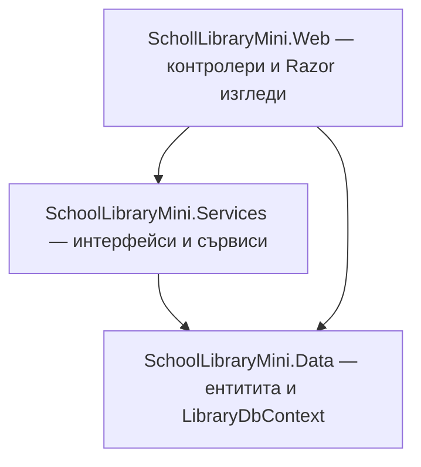

# SchoolLibraryMini

Учебен проект по Интернет програмиране – РПП, 12. клас, разработван с ASP.NET Core MVC, Entity Framework Core и SQL Server. Използваме го като пример за поетапно изграждане на уеб приложение. Всеки ученик прилага същите стъпки към тематиката и моделите на своя проект.

## Етап 1. Модели / ентитита

- Определяме какви обекти ще управлява приложението и какви свойства имат.
- Създаваме класове за тях – в библиотеката това са `Book`, `Author`, `Reader` и `Loan`.
- Добавяме идентификатори и навигационни свойства, които описват връзките между обектите.

**Резултат:** имаме модел на предметната област в C#; само създаването на класовете още не създава база данни.

## Етап 2. База данни с Code First и миграции

- Добавяме EF Core и създаваме `LibraryDbContext` с колекции `DbSet` за ентититата.
- Чрез Fluent API описваме първични и външни ключове, зависимости и ограничения – например `BookId` и `AuthorId` при книгата.
- Настройваме връзката към SQL Server и регистрираме контекста с `AddDbContext` в уеб приложението.
- С `Add-Migration Initial` създаваме миграция, а с `Update-Database` я прилагаме към базата. Избираме проекта за данни за миграциите и уеб проекта за стартиращ проект.

**Резултат:** EF Core преобразува описания с C# модел в таблици, ключове и зависимости. При следваща промяна в модела добавяме нова миграция и я прилагаме.

## Етап 3. Добавяне и показване на данни (опционален за учениците)

- Получаваме контекста чрез конструктора на контролера.
- Добавяме примерни записи с `Add` и ги записваме в базата с `SaveChanges()`.
- Извличаме данни с LINQ и `ToList()`, след което ги предаваме на изгледа с `View(model)`.
- В Razor изглед използваме `@model` и `foreach`, за да покажем записите в HTML таблица. Можем да добавим и форма за въвеждане на нова книга.

**Резултат:** виждаме целия път от базата данни през контролера до страницата. Това е междинна учебна стъпка, в която логиката за работа с данните временно е в контролера.

## Етап 4. Сервизен слой (следваща стъпка)

- Създаваме проект `SchoolLibraryMini.Services` и добавяме необходимите референции между проектите.
- Описваме операциите с интерфейс, например `IBookService`, и ги реализираме в клас `BookService`.
- Изнасяме логиката за работа с книгите от контролера в сървиса, който използва `LibraryDbContext`.
- Регистрираме интерфейса и реализацията с `AddScoped` и подаваме сървиса на контролера чрез конструктора.

**Резултат:** контролерът приема заявката и избира изгледа, сървисът изпълнява операциите, а слоят за данни осигурява достъпа до базата. Съществуващият Razor изглед може да продължи да показва същия модел.

### Зависимости между слоевете след етап 4

Стрелката означава **„проектът има Project Reference към“**, а не посока на HTTP заявка. Схемата показва архитектурата, която изграждаме със сервизния слой.

| Проект | Зависи от | Предназначение |
| --- | --- | --- |
| `SchollLibraryMini.Web` | `SchoolLibraryMini.Services` | Контролерите извикват операциите на сървисите. |
| `SchoolLibraryMini.Services` | `SchoolLibraryMini.Data` | Сървисите използват ентититата и контекста за работа с базата. |
| `SchollLibraryMini.Web` | `SchoolLibraryMini.Data` | В `Program.cs` регистрираме `LibraryDbContext` с `AddDbContext`. |
| `SchoolLibraryMini.Data` | Нито един от другите два проекта | Слоят за данни не познава контролерите и сървисите. |

Добавяме референциите във Visual Studio чрез **Add → Project Reference** върху проекта, който ще използва другия. Не добавяме обратни референции от Data към Services или от Services към Web, защото ще се получи циклична зависимост.

**Пример:** `BooksController` извиква `IBookService.GetAll()`; `BookService` извлича книгите чрез `LibraryDbContext`; контролерът предава резултата на Razor изгледа за показване.

## Етап 5. Модели за пренос на данни и модели за формуляри (DTO и ViewModel)

- Разграничаваме **ентити** (данни и връзки в базата), **DTO** (данни, които сървисът пренася) и **ViewModel** (данни за конкретна страница или форма).
- В `SchoolLibraryMini.Services/DTOs/Books` създаваме `BookListDto` с `BookId`, `Title`, `AuthorName` и `ISBN`. Запазваме идентификатора за бъдещите страници за детайли и редакция.
- Променяме `IBookService.GetAll()` и реализацията му да връщат `Task<List<BookListDto>>`. В сървиса използваме LINQ `Select`, за да изберем нужните полета, включително името на автора чрез `b.Author.Name`.
- В `SchollLibraryMini.Web/ViewModels/Books` създаваме `BooksIndexViewModel` с колекция `Books` от DTO-та. Контролерът попълва този модел и го подава на изгледа.
- Актуализираме `_ViewImports.cshtml` и `Views/Books/Index.cshtml`: изгледът използва `BooksIndexViewModel`, обхожда `Model.Books` и показва заглавие, автор и ISBN. Проверяваме и състоянието при празен списък.

**Архитектурно правило:** ентититата остават в Data, DTO-тата са в Services, а ViewModel-ите са в Web. Services не зависи от Web. DTO и ViewModel не са нови таблици и сами по себе си не изискват миграция.

**Подготовка за формулярите:** в този час прилагаме концепцията към списъка. В следващия етап ще създадем отделни `CreateBookViewModel` за формата и `CreateBookDto` за входа към сървиса, с валидация на въведените данни. Не използваме модела за списъка като универсален модел за всички операции.

**Резултат:** сървисът връща избраните данни чрез DTO, а страницата получава собствен ViewModel. По-късно можем да добавим търсене и странициране към модела на страницата.

**За собствения проект:** създайте аналогични DTO и ViewModel за вашия основен обект, променете сървиса, контролера и списъка. Покажете идентификатор и поне три подходящи полета, проверете компилацията и резултата в браузъра и публикувайте описателен commit.

## Работа по собствения проект

След всеки етап проверете дали приложението се компилира и дали добавената функционалност работи. Направете commit с кратко описание и публикувайте промените в своето GitHub репозитори, за да може напредъкът да бъде проследяван и оценяван. Следвайте идеята на примера, като използвате собствените си ентитита и зависимости.

При всяка следваща тема ще допълваме този README с нов етап.
